### Hi there 👋

<picture>
  <source media="(prefers-color-scheme: dark)" srcset="https://raw.githubusercontent.com/xUmutKx/xUmutKx/cards/summary-dark.svg">
  
</picture>
<picture>
  <source media="(prefers-color-scheme: dark)" srcset="https://raw.githubusercontent.com/xUmutKx/xUmutKx/cards/languages-dark.svg">
  
</picture>

<picture>
  <source media="(prefers-color-scheme: dark)" srcset="https://raw.githubusercontent.com/xUmutKx/xUmutKx/cards/contributions-dark.svg">
  
</picture>
<picture>
  <source media="(prefers-color-scheme: dark)" srcset="https://raw.githubusercontent.com/xUmutKx/xUmutKx/cards/weekly-dark.svg">
  
</picture>

